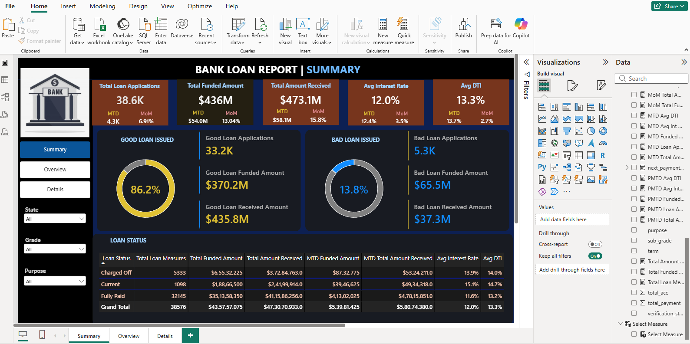
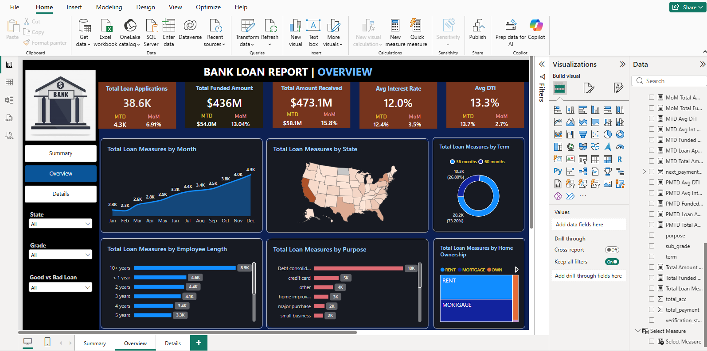
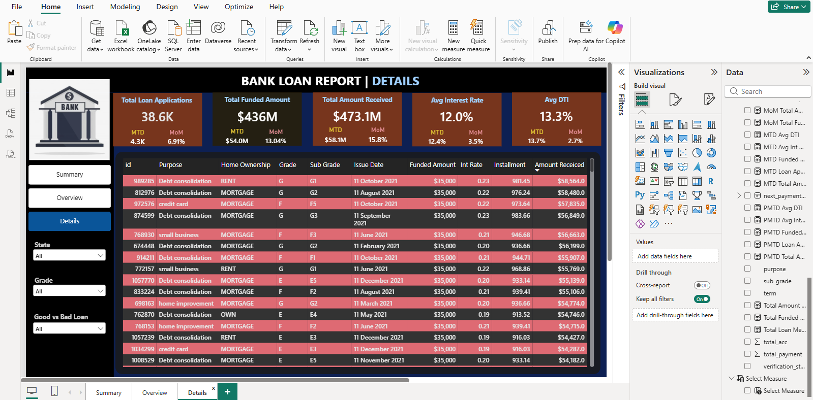

# Bank Loan Analysis | SQL & Power BI

## Project Overview
An end-to-end data analytics project evaluating **38,576 bank loan applications** ($435.8M funded amount) to monitor lending performance, borrower financial health, and portfolio risk. SQL was used to validate business KPIs and granular metrics before building an interactive three-page Power BI dashboard.

---

## Key Performance Indicators (KPIs)
* **Total Loan Applications:** 38,576 (MTD: 4,314 | MoM: +6.91%)
* **Total Funded Amount:** $435.76M (MTD: $53.98M | MoM: +13.04%)
* **Total Amount Received:** $473.07M (MTD: $58.07M | MoM: +15.80%)
* **Average Interest Rate:** 12.05% (MTD: 12.36% | MoM: +3.50%)
* **Average Debt-to-Income (DTI):** 13.33% (MTD: 13.67% | MoM: +2.70%)

---

## Portfolio Health & Key Insights
* **Good Loans vs. Bad Loans:** **86.2%** (33,243 applications) are Good Loans (*Fully Paid* or *Current*), generating $435.79M against $370.22M funded. **13.8%** (5,333 applications) are Bad Loans (*Charged Off*), recovering $37.28M out of $65.53M funded.
* **Monthly Lending Trend:** Loan applications and disbursements grew steadily throughout the year, rising from **2,332 applications ($25.03M)** in January to **4,314 applications ($53.98M)** in December.
* **Loan Purpose & Term:** **Debt Consolidation** is the primary driver (~47% of applications, $232.46M funded), followed by Credit Card repayment. **73.2%** of borrowers prefer 36-month loan terms over 60-month terms.
* **Borrower Profile:** Borrowers with **10+ years** of employment lead application volume (8,870 loans), while **Rent** (18,439) and **Mortgage** (17,198) holders account for the majority of loans.

---

## Dashboard Pages & Features
1. **Summary Dashboard:** Executive KPI cards with MTD and MoM comparisons, Good vs. Bad loan donut charts, and a Loan Status breakdown table.
2. **Overview Dashboard:** Interactive trend and demographic analysis by Month, State (Shape Map), Term, Employee Length, Loan Purpose, and Home Ownership, powered by **Field Parameters** to toggle dynamically between *Total Applications*, *Funded Amount*, and *Amount Received*.
3. **Details Dashboard:** Granular loan-level tabular view with slicers for State, Grade, and Loan Quality (*Good vs. Bad Loan*).

---

## Tools & Skills Used
* **SQL (MySQL):** Aggregations, `CASE` statements, date functions (`MONTH`, `DATENAME`), `GROUP BY`, and KPI validation against dashboard metrics.
* **Power BI Desktop:** Power Query data profiling, custom `CALENDAR` date table, Star Schema relationship modeling, Time Intelligence DAX (`TOTALMTD`, `DATESMTD`, `DATEADD`), Field Parameters, and custom page navigation.

---

## Dashboard Previews

### 1. Summary Dashboard

### 2. Overview Dashboard

### 3. Details Dashboard

